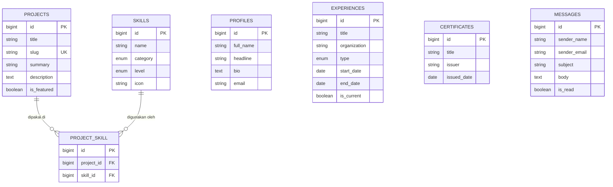
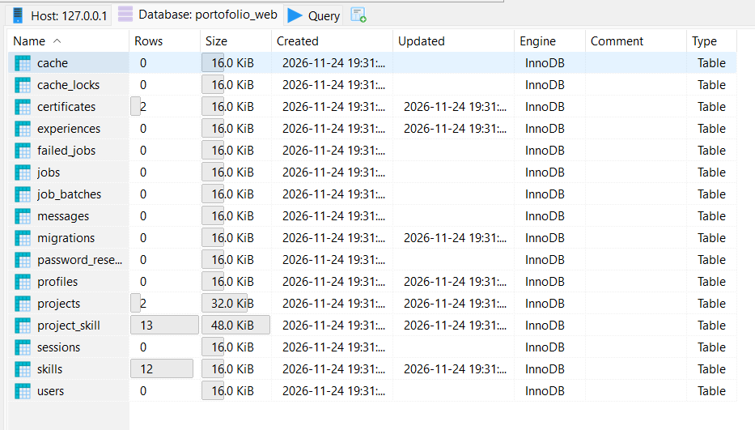
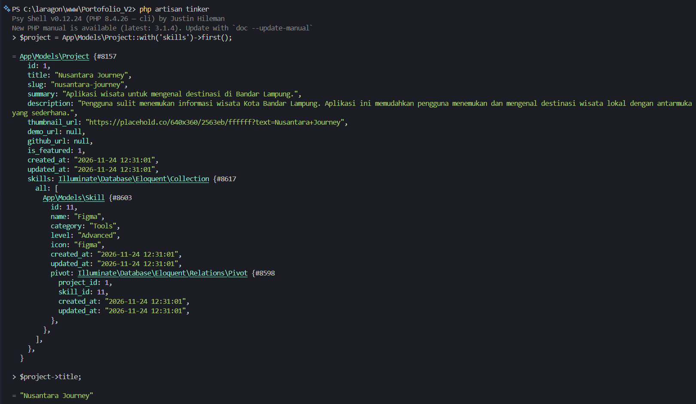

# Latihan 4b — Database Migration, Eloquent Model & Seeder

Data portofolio disimpan di **MySQL** menggunakan Laravel Migration, Eloquent Model, dan Seeder.

> **Pemrograman Web 2 · BE-1b · Desain Database, Migration, Eloquent Model & Seeder**

|                 |                                                                                  |
| --------------- | -------------------------------------------------------------------------------- |
| **Nama**        | Muhammad Arkaan Andrean                                                          |
| **NPM**         | 24312242                                                                         |
| **Kelas**       | IF 24 CX                                                                         |
| **Mata Kuliah** | Pemrograman Web 2                                                                |
| **Branch**      | `Lat-4b_DatabaseModel`                                                           |
| **Repository**  | https://github.com/muhammadarkaanandrean/Portofolio_V2                           |
| **Link Branch** | https://github.com/muhammadarkaanandrean/Portofolio_V2/tree/Lat-4b_DatabaseModel |

<!--  -->

## Daftar Isi

- [Teknologi](#teknologi)
- [Cara Menjalankan](#cara-menjalankan)
- [Skema Database](#skema-database)
- [Relasi Eloquent](#relasi-eloquent)
- [Data Seeder](#data-seeder)
- [Pengujian dengan Tinker](#pengujian-dengan-tinker)
- [Screenshot](#screenshot)
- [Struktur File Latihan 4b](#struktur-file-latihan-4b)
- [Penulis](#penulis)

## Teknologi

| Bagian    | Teknologi           |
| --------- | ------------------- |
| Framework | Laravel             |
| Database  | MySQL (via Laragon) |
| ORM       | Eloquent            |
| Bahasa    | PHP 8.3+            |

## Cara Menjalankan

**Kebutuhan:** PHP 8.3+, Composer, dan MySQL (Laragon).

```bash
# 1. Clone dan masuk ke folder
git clone https://github.com/muhammadarkaanandrean/Portofolio_V2.git
cd Portofolio_V2
git switch Lat-4b_DatabaseModel

# 2. Install dependensi
composer install

# 3. Siapkan environment
copy .env.example .env
php artisan key:generate
```

Buat database kosong bernama `portofolio_web` (Laragon: **Start All**, lalu buka HeidiSQL dan buat database). Pastikan `.env` berisi:

```env
DB_CONNECTION=mysql
DB_HOST=127.0.0.1
DB_PORT=3306
DB_DATABASE=portofolio_web
DB_USERNAME=root
DB_PASSWORD=
```

Lalu jalankan migrasi dan seeder:

```bash
php artisan migrate:fresh --seed
```

Jalankan aplikasi:

```bash
php artisan serve
```

Buka `http://localhost:8000`.

> File `.env` berisi kunci rahasia dan **tidak diunggah** ke GitHub.

## Skema Database

Terdapat **7 tabel**. `project_skill` adalah tabel pivot untuk relasi many-to-many antara `projects` dan `skills`.

### ERD



### Detail tabel

**`profiles`** — biodata pemilik portofolio (1 baris)

| Kolom                                         | Tipe             | Keterangan |
| --------------------------------------------- | ---------------- | ---------- |
| `id`                                          | bigint, PK       |            |
| `full_name`, `headline`                       | string           |            |
| `bio`                                         | text             |            |
| `photo_url`, `cv_url`                         | string, nullable |            |
| `email`                                       | string           |            |
| `phone`, `location`                           | string, nullable |            |
| `github_url`, `linkedin_url`, `instagram_url` | string, nullable |            |

**`skills`**

| Kolom      | Tipe             | Keterangan                                                      |
| ---------- | ---------------- | --------------------------------------------------------------- |
| `id`       | bigint, PK       |                                                                 |
| `name`     | string           | mis. Laravel, Tailwind CSS                                      |
| `category` | enum             | `Frontend`, `Backend`, `Database`, `Tools`                      |
| `level`    | enum             | `Beginner`, `Intermediate`, `Advanced` (default `Intermediate`) |
| `icon`     | string, nullable | slug ikon devicon                                               |

**`projects`**

| Kolom                                     | Tipe               | Keterangan                    |
| ----------------------------------------- | ------------------ | ----------------------------- |
| `id`                                      | bigint, PK         |                               |
| `title`                                   | string             |                               |
| `slug`                                    | string, **unique** | untuk URL ramah SEO           |
| `summary`                                 | string             | deskripsi singkat untuk kartu |
| `description`                             | text               | penjelasan lengkap            |
| `thumbnail_url`, `demo_url`, `github_url` | string, nullable   |                               |
| `is_featured`                             | boolean            | default `false`               |

**`project_skill`** (pivot)

| Kolom        | Tipe       | Keterangan                                           |
| ------------ | ---------- | ---------------------------------------------------- |
| `id`         | bigint, PK |                                                      |
| `project_id` | foreignId  | → `projects.id`, `cascadeOnDelete`                   |
| `skill_id`   | foreignId  | → `skills.id`, `cascadeOnDelete`                     |
|              |            | pasangan `project_id` + `skill_id` bersifat **unik** |

**`experiences`**

| Kolom                   | Tipe           | Keterangan                                    |
| ----------------------- | -------------- | --------------------------------------------- |
| `id`                    | bigint, PK     |                                               |
| `title`, `organization` | string         |                                               |
| `type`                  | enum           | `Pendidikan`, `Organisasi`, `Magang`, `Kerja` |
| `start_date`            | date           |                                               |
| `end_date`              | date, nullable | null jika masih berjalan                      |
| `is_current`            | boolean        | default `false`                               |
| `description`           | text, nullable |                                               |

**`certificates`**

| Kolom             | Tipe             | Keterangan                   |
| ----------------- | ---------------- | ---------------------------- |
| `id`              | bigint, PK       |                              |
| `title`, `issuer` | string           | nama sertifikat dan penerbit |
| `issued_date`     | date             |                              |
| `credential_url`  | string, nullable | tautan verifikasi            |
| `description`     | text, nullable   |                              |

**`messages`** — pesan dari form kontak

| Kolom                                    | Tipe       | Keterangan      |
| ---------------------------------------- | ---------- | --------------- |
| `id`                                     | bigint, PK |                 |
| `sender_name`, `sender_email`, `subject` | string     |                 |
| `body`                                   | text       |                 |
| `is_read`                                | boolean    | default `false` |

## Relasi Eloquent

| Model     | Relasi                                                          | Keterangan                       |
| --------- | --------------------------------------------------------------- | -------------------------------- |
| `Project` | `skills()` → `belongsToMany(Skill::class, 'project_skill')`     | 1 proyek memakai banyak skill    |
| `Skill`   | `projects()` → `belongsToMany(Project::class, 'project_skill')` | 1 skill dipakai di banyak proyek |

**Mass assignment:** `Message` memakai `$fillable` (whitelist) karena menerima input langsung dari pengunjung, sehingga kolom seperti `is_read` tidak bisa dimanipulasi. Model lain memakai `$guarded = ['id']`.

## Data Seeder

`php artisan migrate:fresh --seed` menjalankan `PortfolioSeeder` yang mengisi:

| Tabel          | Jumlah | Keterangan                                             |
| -------------- | ------ | ------------------------------------------------------ |
| `profiles`     | 1      | biodata dan tautan sosial                              |
| `skills`       | 12     | Frontend, Backend, Database, Tools                     |
| `projects`     | 4      | masing-masing terhubung ke skill lewat `project_skill` |
| `experiences`  | 3      | pendidikan dan organisasi                              |
| `certificates` | 2      | sertifikat                                             |

Relasi proyek dan skill memakai `sync()` supaya tidak terduplikasi bila seeder dijalankan ulang.

## Pengujian dengan Tinker

```bash
php artisan tinker
```

```php
$project = App\Models\Project::with('skills')->first();
$project->title;
$project->skills->pluck('name');
```

## Screenshot

<!-- Simpan gambar di folder docs/ lalu hapus tanda komentar pada baris di bawah. -->

**Tabel di database**



**Hasil Tinker**



## Struktur File Latihan 4b

```
├── app/
│   └── Models/
│       ├── Profile.php
│       ├── Skill.php
│       ├── Project.php
│       ├── Experience.php
│       ├── Certificate.php
│       └── Message.php
└── database/
    ├── migrations/
    │   ├── 2026_11_09_000001_create_profiles_table.php
    │   ├── 2026_11_09_000002_create_skills_table.php
    │   ├── 2026_11_09_000003_create_projects_table.php
    │   ├── 2026_11_09_000004_create_project_skill_table.php
    │   ├── 2026_11_09_000005_create_experiences_table.php
    │   ├── 2026_11_09_000006_create_certificates_table.php
    │   └── 2026_11_09_000007_create_messages_table.php
    └── seeders/
        ├── DatabaseSeeder.php
        └── PortfolioSeeder.php
```

## Penulis

**Muhammad Arkaan Andrean**
Mahasiswa Informatika, Universitas Teknokrat Indonesia
Bandar Lampung, Indonesia
